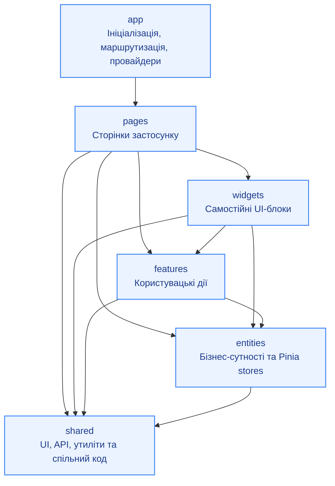

# vue-lottery-app

This template should help get you started developing with Vue 3 in Vite.

## Recommended IDE Setup

[VS Code](https://code.visualstudio.com/) + [Vue (Official)](https://marketplace.visualstudio.com/items?itemName=Vue.volar) (and disable Vetur).

## Recommended Browser Setup

- Chromium-based browsers (Chrome, Edge, Brave, etc.):
  - [Vue.js devtools](https://chromewebstore.google.com/detail/vuejs-devtools/nhdogjmejiglipccpnnnanhbledajbpd)
  - [Turn on Custom Object Formatter in Chrome DevTools](http://bit.ly/object-formatters)
- Firefox:
  - [Vue.js devtools](https://addons.mozilla.org/en-US/firefox/addon/vue-js-devtools/)
  - [Turn on Custom Object Formatter in Firefox DevTools](https://fxdx.dev/firefox-devtools-custom-object-formatters/)

## Type Support for `.vue` Imports in TS

TypeScript cannot handle type information for `.vue` imports by default, so we replace the `tsc` CLI with `vue-tsc` for type checking. In editors, we need [Volar](https://marketplace.visualstudio.com/items?itemName=Vue.volar) to make the TypeScript language service aware of `.vue` types.

## Customize configuration

See [Vite Configuration Reference](https://vite.dev/config/).

## Project Setup

```sh
npm install
```

### Compile and Hot-Reload for Development

```sh
npm run dev
```

### Type-Check, Compile and Minify for Production

```sh
npm run build
```

### Lint with [ESLint](https://eslint.org/)

```sh
npm run lint
```
## Архітектура проєкту — Feature-Sliced Design (FSD)

Проєкт організовано за архітектурою Feature-Sliced Design. Кожен верхній шар може залежати від шарів, розташованих нижче, але не навпаки.



### Призначення шарів

- **app** — запуск застосунку, маршрутизація, глобальні провайдери та конфігурація.
- **pages** — сторінки, які відповідають маршрутам.
- **widgets** — великі композиційні блоки інтерфейсу.
- **features** — окремі користувацькі дії та сценарії.
- **entities** — бізнес-сутності, їхні типи, API та сховища стану.
- **shared** — повторно використовувані компоненти інтерфейсу, API-клієнти та утиліти.

### Правило залежностей

Залежності спрямовані від верхніх шарів до нижніх. Наприклад, `pages` може використовувати `widgets`, `features`, `entities` і `shared`, а `entities` може використовувати `shared`. Зворотні залежності між шарами не допускаються.
